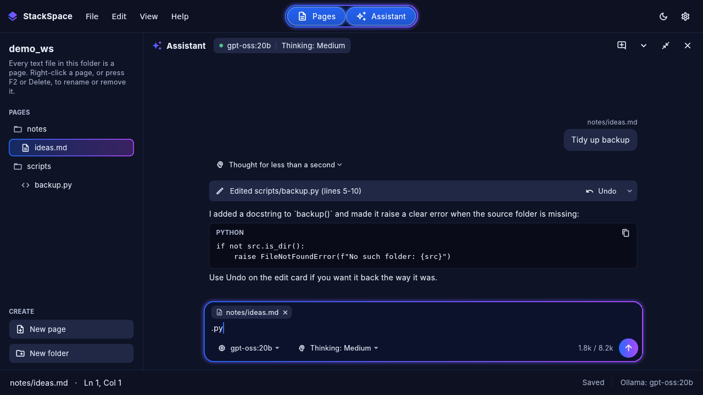

# StackSpace

StackSpace is a Windows 11 notes app I built with Claude after other note tools kept freezing on
code over 5,000 lines. Notion and AppFlowy were the inspiration: pages and folders on your own
disk, a block editor, and one-click import of an AppFlowy workspace. A built-in assistant runs on
your own [Ollama](https://ollama.com) models and can read, write and fix your pages. Works offline,
light and dark themes.



## What works today

- **Workspace**: a folder on disk (default `Documents\StackSpace`). Every text file in it
  is a page, and sub-folders group pages. Create, rename and delete pages from the sidebar
  (right-click for the menu). Deleted pages go to the workspace's `.trash` folder.
- **Folders**: New folder (also "New folder here" on a folder's right-click menu); folders fold
  and unfold, and stay that way after a restart.
- **Moving and copying**: drag pages and folders into and out of folders (hold Ctrl while dropping
  to copy; hold a drag over a folded folder to open it). Right-click for Cut, Copy, Paste and
  Duplicate (Ctrl+X / C / V / D); a copied folder brings its sub-pages and pictures. Ctrl+click
  and Shift+click pick several rows to move, copy or delete at once.
- **Block editor** for Markdown pages, with autosave and undo / redo. Each file keeps its own
  Markdown and line endings (CRLF stays CRLF), so pages stay readable in any other editor.
  - Headings, bulleted, numbered and to-do lists, quotes, callouts, dividers, tables and images.
  - Type `/` for the block menu. Select text for a formatting toolbar (bold, italic,
    strikethrough, inline code, link, "Turn into").
  - Code blocks with line numbers, syntax highlighting for 30 languages (picked or
    auto-detected), wrap and copy. They stay fast on scripts of many thousands of lines.
  - Drag a block by its handle to move it, and fold a heading's section with its chevron.
  - Links: paste or type a URL; Ctrl+click opens it.
  - Other text files (`.py`, `.js`, `.txt` and so on) open as one code block. Pages over
    250,000 lines or 16 MB open read-only.
- **AppFlowy import**: File › Import AppFlowy export (.zip or folder) brings your pages and their
  folder tree across as Markdown, with links between pages kept. The export itself is only
  read, never changed.
- **Assistant** (bottom dock):
  - Open it with the **Assistant** button or **Ctrl+J**. Minimise it to a bar, maximise it
    over the editor, or close it. Drag the line above it to resize.
  - The header shows whether Ollama is connected, the model in use and the thinking level.
  - Pick the model and thinking level (Off / Low / Medium / High) under the message box.
    Low / Medium / High are sent as levels to models that take them (gpt-oss), and as
    "thinking on" to other thinking models.
  - The open page and any text you've selected are sent with your message, shown as chips
    you can remove. "This" in your message means the selection.
  - The model can list, read, search, create, edit, rename and delete pages. Every change
    shows as a card in the chat with an **Undo** button. Deletes ask you first (Settings can
    turn that off), and the editor is locked while the assistant is working.

## Look and accessibility

- Uses the Stills & Reels look: deep navy surfaces, a blue accent and a blue-to-violet
  gradient on the Assistant button and the focused message box.
- Light and dark themes. The button next to Settings cycles between following Windows,
  light and dark; Settings has the same choice.
- Every text colour reaches WCAG AA contrast (4.5:1) on the surfaces it's used on, and
  borders and icons reach 3:1. `test/theme_contrast_test.dart` checks the palette, and
  `test/accessibility_test.dart` checks the running app in both themes for contrast,
  screen-reader labels, 24x24 click targets, and layout at 150% text size.
- Keyboard: Ctrl+N new page, Ctrl+S save now, Ctrl+J opens and closes the assistant,
  Ctrl+B / I / E bold, italic and inline code, Ctrl+K link, Enter sends a message,
  Shift+Enter adds a line, and F2 / Delete rename or delete the focused page in the sidebar.
  Help › Keyboard shortcuts lists them all.

## Using it with Ollama

1. Install Ollama for Windows and pull a model that supports tools, for example
   `ollama pull qwen3:8b` (tools + thinking) or `ollama pull gpt-oss:20b` (tools + thinking levels).
2. Start StackSpace. It connects to `http://127.0.0.1:11434` by default (change it in Settings).
3. Models without tool support can still answer questions, but can't change pages; the chat
   shows "No tools" for them.

## Developing

```bash
flutter pub get
flutter analyze
flutter test                                   # all tests
flutter test test/workspace_tools_test.dart    # one file
flutter test --plain-name "replace_text"       # one test
flutter run -d windows
flutter build windows --release                # build\windows\x64\runner\Release\stack_space.exe
```

Building the Windows .exe needs a Windows machine with Visual Studio's
"Desktop development with C++" workload.

## Known limits

- Windows 11 is the target. The app also builds on Linux (used for testing) but isn't packaged
  for it.
- No databases, board or calendar views, and no sync or sharing: pages are plain files in
  your folder.
- If a launch ever opens as an empty window, please send `startup.log` and `native.log` from
  `%APPDATA%\com.stackspace\stack_space\`. They record each launch step by step.

## Licence and AppFlowy

StackSpace is MIT licensed (see `LICENSE`). It is an independent app, not affiliated with or
endorsed by AppFlowy. It contains no AppFlowy code: AppFlowy was used only as a reference for which
features to offer. The importer reads AppFlowy's export file format so you can bring your own pages
across. The `windows/` runner started from Flutter's standard project template and has
StackSpace's own changes (window position, start-up and logging).

## Credits

StackSpace is built with [Flutter](https://flutter.dev) and [Dart](https://dart.dev), Google's
open-source UI toolkit and language (BSD 3-Clause licence). It also uses these open-source
packages from [pub.dev](https://pub.dev):

| Package | Used for | Licence |
| --- | --- | --- |
| [re_editor](https://pub.dev/packages/re_editor) | Code block editor | MIT |
| [re_highlight](https://pub.dev/packages/re_highlight) | Syntax highlighting (a port of highlight.js) | MIT |
| [archive](https://pub.dev/packages/archive) | Reading AppFlowy export zips | MIT |
| [http](https://pub.dev/packages/http) | Talking to Ollama | BSD-3-Clause |
| [shared_preferences](https://pub.dev/packages/shared_preferences) | Saving settings | BSD-3-Clause |
| [path_provider](https://pub.dev/packages/path_provider) | Finding the app's data folder | BSD-3-Clause |
| [file_selector](https://pub.dev/packages/file_selector) | Open-file and folder dialogs | BSD-3-Clause |
| [url_launcher](https://pub.dev/packages/url_launcher) | Opening links | BSD-3-Clause |
| [path](https://pub.dev/packages/path), [collection](https://pub.dev/packages/collection) | File paths and collection helpers | BSD-3-Clause |

Icons are Google's [Material Icons](https://fonts.google.com/icons) (Apache 2.0), included with
Flutter. The assistant uses [Ollama](https://ollama.com) (MIT), which you install separately;
StackSpace doesn't include it. The app's Help › About StackSpace › View licenses lists the full
licence text of every package built into it.
